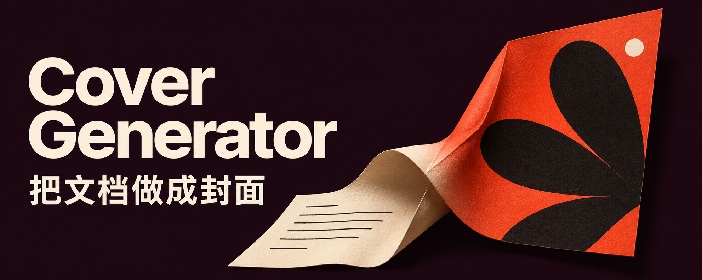

<p align="center">
  
</p>

# Cover Generator｜封面生成

给 Codex 一份文档、一段文案或一个项目目录，再选一个模板、提供一张个人照片。Cover Generator 会提炼标题和要点，排成一张 **3:4 中文社交媒体封面**。

**[复制给 Agent 安装](#安装)**　·　[浏览六种模板](#六种模板)　·　[查看用法](#使用方式)

## 六种模板

<table>
  <tr>
    <td align="center"><br/><b>01 课堂清单</b></td>
    <td align="center"><br/><b>02 暗底高对比</b></td>
    <td align="center"><br/><b>03 浅色技术卡片</b></td>
  </tr>
  <tr>
    <td align="center"><br/><b>04 产品演示卡片</b></td>
    <td align="center"><br/><b>05 手账标注</b></td>
    <td align="center"><br/><b>06 荧光信息板</b></td>
  </tr>
</table>

六张内置模板均为重新绘制的合成示意图，不含真人照片、可识别人脸或第三方品牌标志。模板图片只用于构图与风格参考；只有在生成最终封面时，才使用用户主动提供并授权处理的个人照片。生成结果不得复制模板文字、账号标识、水印或未经授权的品牌标志。

## 安装

把下面这段完整复制给 Codex 或其他支持 Skill 的 Agent：

```text
请安装下面这个 Cover Generator Skill，并全局安装到 ~/.codex/skills/cover-generator。
安装完成后请检查 SKILL.md、references 文件和 6 张模板图片是否完整，并告诉我校验结果。

https://github.com/qiushibang/cover-generator
```

也可以手动克隆到 Codex 全局技能目录：

```bash
git clone https://github.com/qiushibang/cover-generator.git ~/.codex/skills/cover-generator
```

也可以下载仓库中的 `cover-generator.zip`，解压到 `~/.codex/skills/`。

## 使用方式

安装后新建一次对话，并描述需要制作中文社交媒体封面。技能会依次：

1. 展示全部六种模板。
2. 让用户选择模板，并收集个人照片。
3. 从手动文案、上传文档或当前目录中获得内容。
4. 自动生成封面文案并制作图片。
5. 检查文字准确性、人物识别度和斜向视觉效果。

示例：

```text
请使用 Cover Generator，根据我上传的项目说明和个人照片制作封面。
```

## 目录结构

```text
cover-generator/
├── SKILL.md
├── README.md
├── assets/
│   ├── repository-cover.png
│   └── templates/
└── references/
    ├── content-source-workflow.md
    └── template-guide.md
```

## 内容与隐私边界

读取当前工作目录时，技能优先使用 README、项目文档和项目配置；默认排除环境变量、密钥、令牌、依赖目录、构建产物、缓存与数据库导出。封面文案必须来自可核验的输入内容，不得虚构效果、指标或产品能力。
